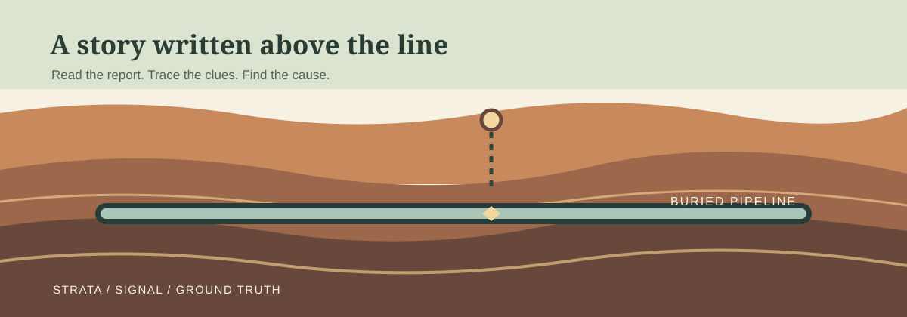
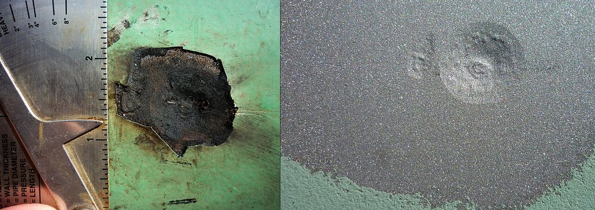
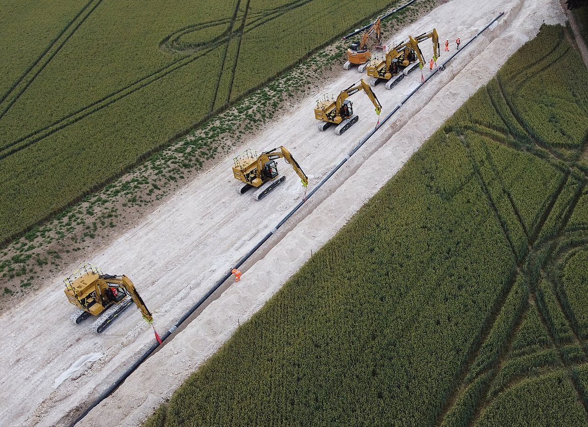
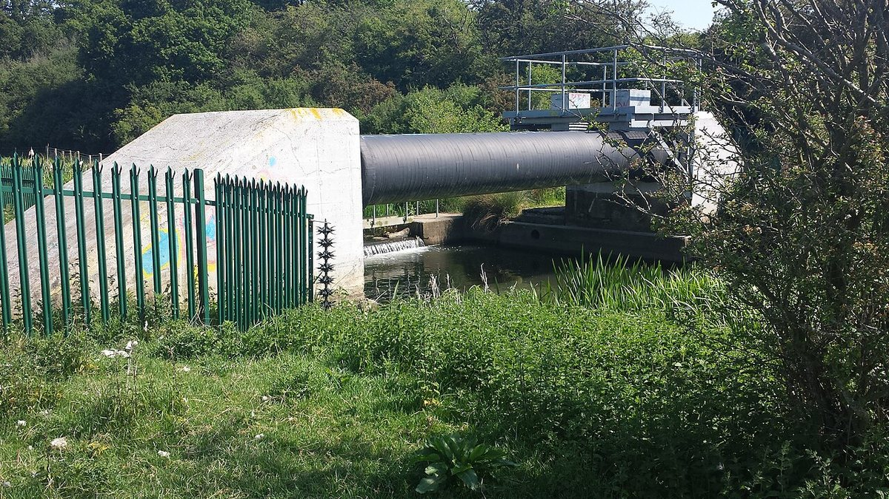
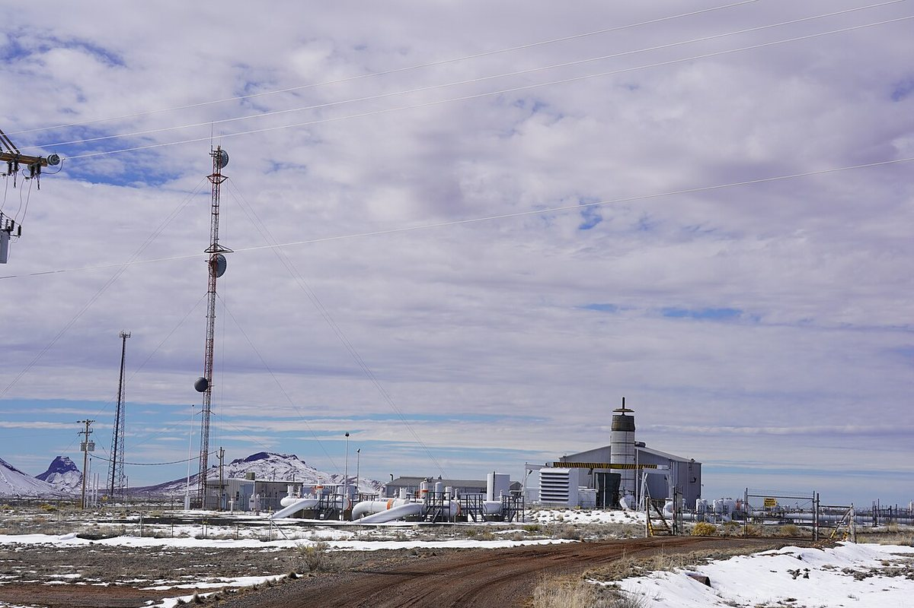
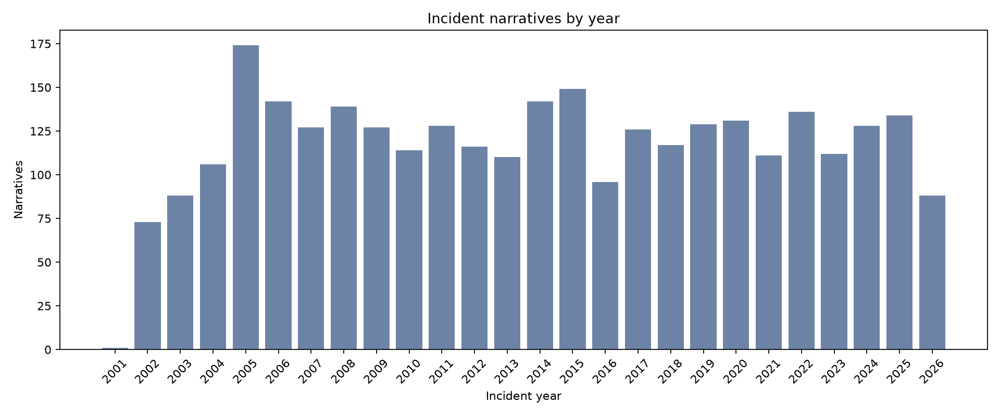
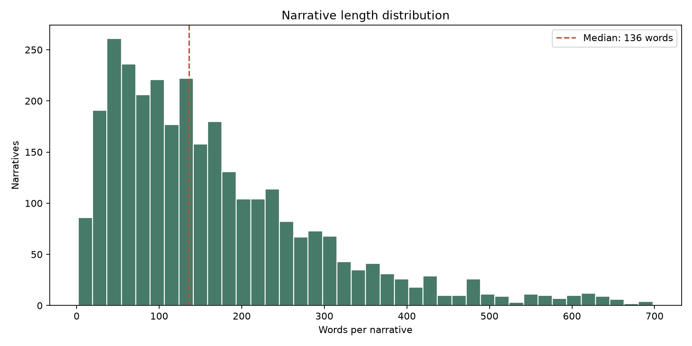
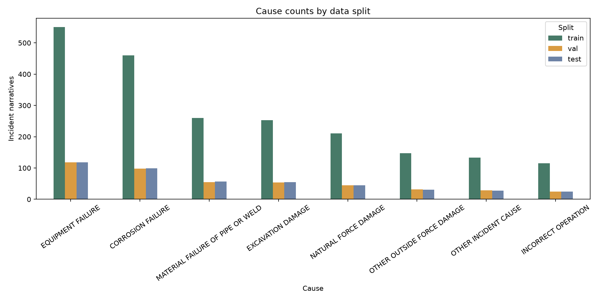
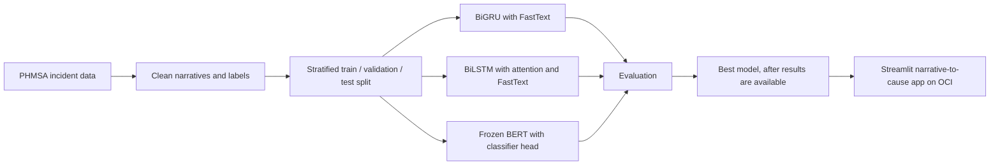
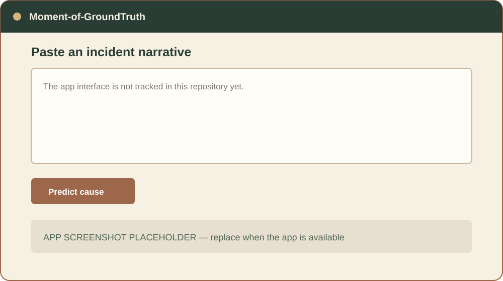

# Moment of GroundTruth

> Every pipeline incident has a moment of truth. We dig down to the ground truth: the root cause.

**Name meaning:** “Moment of truth” is the instant something is decided, and “ground truth” is the machine learning term for the correct label. Here the correct label is the **CAUSE** of a gas pipeline incident, and pipelines are buried in the ground.

[](https://www.python.org/)
[](https://pytorch.org/)
[](https://streamlit.io/)
[](#license)



## Chapter 0 — Header

This project reads the written account of a U.S. gas transmission or gathering pipeline incident and predicts its cause from eight categories. The work moves from public incident reports, through three text models, to a Streamlit app intended to return a predicted cause when someone pastes in a narrative.

## Chapter 1 — Something underground goes wrong

Pipelines move gas across long distances, often out of sight. When a line fails, the consequences can reach people, homes, and the land above it.

The [National Transportation Safety Board (NTSB)](https://www.ntsb.gov/investigations/Pages/DCA10MP008.aspx) investigated a natural gas transmission pipeline rupture in San Bruno, California, on September 9, 2010. The NTSB recorded 8 deaths and 58 injuries (10 serious and 48 minor); 38 homes were destroyed and 70 were damaged. Its report describes a defective seam weld and a pressure increase before the rupture ([NTSB investigation](https://www.ntsb.gov/investigations/Pages/DCA10MP008.aspx), [accident report](https://www.ntsb.gov/investigations/AccidentReports/Reports/PAR1101.pdf)).

Earlier, on August 19, 2000, a natural gas pipeline ruptured near Carlsbad, New Mexico. The NTSB attributed the failure to severe internal corrosion and recorded 12 deaths, no serious or minor injuries, and reported property and other losses of $998,296 ([NTSB accident report](https://www.ntsb.gov/investigations/AccidentReports/Reports/PAR0301.pdf)).

These are two documented examples, not a measure of how often any cause occurs. The project dataset uses eight cause labels: equipment failure, corrosion failure, material failure of pipe or weld, excavation damage, natural force damage, other outside force damage, other incident cause, and incorrect operation. Later chapters show what those labels look like in the reports.

The photographs below show pipeline infrastructure and conditions, not the two incidents described above. The construction and river-crossing photographs were taken in England; they are illustrative, not U.S. incident evidence.



*Corrosion can leave a pit in the steel wall of a buried gas pipeline.*



*A pipeline trench puts heavy machinery and pipe-laying work in the same narrow strip of ground.*



*A river crossing is one place where water and ground movement matter.*



*Compressor stations contain equipment that helps move gas through a transmission system.*

## Chapter 2 — The paperwork nobody has time to read

When an operator discovers a reportable gas pipeline incident, federal rules require an incident report no later than 30 days after discovery ([49 CFR § 191.15](https://www.ecfr.gov/current/title-49/subtitle-B/chapter-I/subchapter-D/part-191/section-191.15)). The narrative is written in ordinary language. Across thousands of reports, reading every account by hand takes time.

Here is one short excerpt from the project CSV for each cause class. Operator names are omitted. The wording is kept as it appears in the source narrative, including its original capitalization and spelling.

**Equipment Failure**
> “line separated at the coupling, mp 63.988 on the north main loop line near the onward compressor station.”

**Corrosion Failure**
> “while conducting a c p survey, pipeline personnel located a gas leak.”

**Material Failure of Pipe or Weld**
> “crack propagated to critical size by fatigue due to effects of operating pressure cycles.”

**Excavation Damage**
> “landowner was using a backhoe to dig ditches and a hole for a new septic system on his property.”

**Natural Force Damage**
> “the pipe pulled apart in the bottom of a small creek crossing.”

**Other Outside Force Damage**
> “the puncture was apparently caused by a large caliber fire arm.”

**Other Incident Cause**
> “gas bubbles were visible and that no sheen was evident on the water.”

**Incorrect Operation**
> “the low pressure suction shutdown switch had been de-activated, allowing the low pressure blower to continue to run, pulling the developing explosive fuel/air mixture through the flare system.”

Each line is a small core sample: useful, but not the whole report. The model sees the narrative text, not the operator name.

## Chapter 3 — Taking a core sample

The raw PHMSA CSV contains 3,044 rows. All 3,044 narratives are usable — no records were removed. Its columns are `REPORT_NUMBER`, `IYEAR`, `NAME`, `CAUSE`, `CAUSE_DETAILS`, and `NARRATIVE`. `NARRATIVE` is the model input; `CAUSE` is the label. `NAME` is present in the source data but is not printed with the excerpts above.

The source is public [PHMSA Gas Transmission and Gathering Incident Data](https://www.phmsa.dot.gov/data-and-statistics/pipeline/pipeline-incident-20-year-trends), from the U.S. Department of Transportation’s Pipeline and Hazardous Materials Safety Administration (PHMSA). Pipeline operators submit the reports on Form PHMSA F 7100.2. The project merged the 2002–2009 historical file with the 2010–present file and mapped older cause labels into the current eight categories. All records in this raw CSV have a usable narrative.

The source narratives are mostly uppercase and include extra whitespace. Five are not entirely uppercase; cleaning lowercases all rows.

### Incidents by cause

Counts and percentages below were computed from the supplied CSV. Percentages are rounded to one decimal place.

| Cause | Narratives | Share |
|---|---:|---:|
| Equipment Failure | 787 | 25.9% |
| Corrosion Failure | 657 | 21.6% |
| Material Failure of Pipe or Weld | 372 | 12.2% |
| Excavation Damage | 362 | 11.9% |
| Natural Force Damage | 301 | 9.9% |
| Other Outside Force Damage | 210 | 6.9% |
| Other Incident Cause | 190 | 6.2% |
| Incorrect Operation | 165 | 5.4% |

*Equipment Failure is the largest group in this file. Incorrect Operation is the smallest.*

### Incidents by year



*The CSV contains one 2001 record and 88 records from 2026. The 2026 count is a partial-year snapshot, not a full-year total.*

### Narrative length



*Using whitespace-separated word counts, the median narrative has 136 words and the mean is 167.25 words.*

### The planned split

Text is cleaned by unescaping HTML entities, removing real HTML tags, fixing whitespace, and converting to lowercase. A stratified split keeps the cause proportions similar in each partition. “Stratified” means each split is sampled to preserve the class mix.

| Partition | Share | Narratives |
|---|---:|---:|
| Train | 70% | 2,130 |
| Validation | 15% | 456 |
| Test | 15% | 458 |
| Total | 100% | 3,044 |



*The files use a leakage-safe stratified split at the cleaned-narrative group level and are reproducible with seed 42.*

### Reproduce the data split

```powershell
pip install -r requirements.txt
python scripts/prepare_data.py
```

## Chapter 4 — Three drills, one dig site

The three models use the same cleaned dataset and split. All three crew members share data preparation, cleaning, historical-data merging, splitting, and final analysis.

### Parva’s speed-reader: BiGRU

A GRU is a recurrent neural network that carries a compact state as it reads tokens. A bidirectional GRU reads in both directions. Parva’s model uses pretrained FastText word embeddings: vectors learned from a large text collection before this task.

```text
Narrative tokens --> forward GRU ----\
                                      +--> combine --> cause classifier --> 8 classes
Narrative tokens --> backward GRU ---/
```

### Muhammad’s highlighter: BiLSTM with attention

An LSTM is a recurrent network with gates that help it retain or forget information. Muhammad’s bidirectional LSTM also uses attention, a mechanism that learns which token representations to emphasize. It uses pretrained FastText embeddings.

```text
Narrative tokens --> forward LSTM ---\
                                      +--> attention --> cause classifier --> 8 classes
Narrative tokens --> backward LSTM --/
```

### Sakina’s scholar: BERT

BERT is a transformer language model pretrained on text. This version uses `bert-base-uncased`; its 12 layers, 12 attention heads, and 768-number token vectors are kept frozen. Only the classification head is trained. The head maps the 768-number `[CLS]` vector to 8 cause scores, with 6,152 trainable weights.

```text
Narrative --> BERT-base-uncased (frozen) --> [CLS] vector (768)
          --> trainable head (768 -> 8) --> predicted cause
```

### From incident report to app



## Chapter 5 — The moment of truth: who digs deepest?

The model results are not all finished or recorded in this repository. These tables are intentionally blank until measured scores are available. No metric is estimated.

| Cause | BiGRU Precision | BiGRU Recall | BiGRU F1 | BiLSTM Precision | BiLSTM Recall | BiLSTM F1 | BERT Precision | BERT Recall | BERT F1 |
|---|---:|---:|---:|---:|---:|---:|---:|---:|---:|
| Equipment Failure | TODO | TODO | TODO | TODO | TODO | TODO | TODO | TODO | TODO |
| Corrosion Failure | TODO | TODO | TODO | TODO | TODO | TODO | TODO | TODO | TODO |
| Material Failure of Pipe or Weld | TODO | TODO | TODO | TODO | TODO | TODO | TODO | TODO | TODO |
| Excavation Damage | TODO | TODO | TODO | TODO | TODO | TODO | TODO | TODO | TODO |
| Natural Force Damage | TODO | TODO | TODO | TODO | TODO | TODO | TODO | TODO | TODO |
| Other Outside Force Damage | TODO | TODO | TODO | TODO | TODO | TODO | TODO | TODO | TODO |
| Other Incident Cause | TODO | TODO | TODO | TODO | TODO | TODO | TODO | TODO | TODO |
| Incorrect Operation | TODO | TODO | TODO | TODO | TODO | TODO | TODO | TODO | TODO |

| Model | Macro F1 | Micro F1 | Accuracy |
|---|---:|---:|---:|
| BiGRU with FastText | TODO | TODO | TODO |
| BiLSTM with attention and FastText | TODO | TODO | TODO |
| Frozen BERT with classifier head | TODO | TODO | TODO |

**Best model:** TODO — choose only after comparing measured validation results and reporting the held-out test results.

**How to read these numbers:** Precision asks, “When the model predicts this cause, how often is it right?” Recall asks, “Of the reports with this cause, how many did it find?” F1 balances precision and recall. Macro F1 averages the class scores equally; micro F1 pools decisions across examples. Accuracy is the share of all predictions that are correct.

Class-weighted loss gives less common classes more influence during training. It is a training choice, not a substitute for reporting per-class results.

## Chapter 6 — Ground control

The planned deliverable is a Streamlit web app: a person pastes in an incident narrative and receives a predicted cause. The project brief says the app is deployed on Oracle Cloud Infrastructure (OCI), but this repository contains no app source, live URL, deployment configuration, model weights, or screenshot. The image below is a placeholder, not a screenshot of a running app.



The app page title should be **Moment-of-GroundTruth**. When the application source is added, set its Streamlit page title to that exact project name:

```python
st.set_page_config(page_title="Moment-of-GroundTruth")
```

**Run locally:** The app cannot run from this repository yet because neither an app entry point nor a dependency file is tracked. Once those files are added, the expected shape of the workflow is to install the pinned dependencies and run `streamlit run app.py` from the project root. That command is not runnable here until `app.py` and its dependencies are added. The data-chart script in Chapter 7 is runnable now.

**Deploy to OCI:** The target platform is OCI, but the repository does not record which OCI service, instance, network rules, startup command, or public endpoint is in use. A typical VM deployment would install the pinned dependencies, start Streamlit on the configured host and port, and allow that traffic through the OCI network rules; add the actual resource and network details before treating this as a reproducible deployment recipe. Do not commit credentials or private keys.

## Chapter 7 — Dig site map

The repository is a small project shell today:

```text
.
|-- README.md
|-- docs
|   `-- images
|       |-- CREDITS.md
|       |-- app-screenshot-placeholder.svg
|       |-- bedrock-hero.svg
|       |-- chart-cause-counts.png
|       |-- chart-data-split.png
|       |-- chart-incidents-by-year.png
|       |-- chart-narrative-lengths.png
|       |-- dilkon-compressor-station.jpg
|       |-- gas-pipeline-construction.jpg
|       |-- gas-pipeline-river-crossing.jpg
|       `-- pipeline-corrosion.jpg
|-- scripts
|   `-- generate_readme_charts.py
|-- muhammad
|   `-- README.md
|-- parva
|   `-- README.md
`-- sakina
    `-- README.md
```

The actual GitHub repository path remains [`sakina-saifuddin/GroundTruth`](https://github.com/sakina-saifuddin/GroundTruth), and the local checkout folder is `GroundTruth`. Both names are left unchanged.

To check out this documentation branch, use the existing repository slug and folder name:

```text
git clone https://github.com/sakina-saifuddin/GroundTruth.git
cd GroundTruth
git switch docs/readme-story
```

### Reproduce the README charts

1. Download the public gas transmission and gathering incident files from [PHMSA’s pipeline incident data page](https://www.phmsa.dot.gov/data-and-statistics/pipeline/pipeline-incident-20-year-trends). The supplied project CSV is not tracked in this repository.
2. Use Python 3 and install Matplotlib and Pillow: `python -m pip install matplotlib pillow`.
3. Run the chart generator with the path to the merged CSV:

   ```text
   python scripts/generate_readme_charts.py --csv path/to/PHMSA_Gas_Transmission_Gathering_2002_Present.csv
   ```

4. The script writes the four chart images into `docs/images/`.

The chart generator is the only reproducible script currently present. Model training notebooks, source code, environment pins, preprocessing scripts, and model weights are not in the repository, so their run order and exact commands cannot be verified here.

## Chapter 8 — Limits and next steps

- The model labels past incident narratives. It does not predict whether or when a future incident will happen.
- The classes are imbalanced: Equipment Failure makes up 25.8% of the supplied data, while Incorrect Operation makes up 5.4%. Class-weighted loss addresses this during training but does not make the dataset balanced.
- Frozen BERT trains fewer parameters than full fine-tuning, but may be less effective for this task. That is a possibility to test, not a result.
- BERT-base-uncased accepts at most 512 tokens at a time. Longer narratives need a documented truncation or chunking policy.
- Operators file the incident reports. Older cause labels were mapped to the current eight categories, so the labels reflect reporting and mapping choices.
- The raw CSV has one `IYEAR` value of 2001 and 88 of 2026. The 2001 report describes an incident on 11-7-2001 discovered on 1-21-02; both it and the partial-year 2026 records are retained.
- The per-class scores, model comparison, chosen best model, app URL, deploy recipe, and app screenshot remain TODOs.

## Chapter 9 — Crew and credits

**Group 1**

- **Sakina Saifuddin** — frozen BERT-base-uncased classifier.
- **Muhammad Murtaza** — BiLSTM with attention and pretrained FastText embeddings.
- **Parva Shah** — BiGRU with pretrained FastText embeddings.

All three crew members share data preparation, cleaning, historical-data merging, splitting, and final analysis.

**Data credit:** Public PHMSA Gas Transmission and Gathering Incident Data, U.S. Department of Transportation, Pipeline and Hazardous Materials Safety Administration. The source narratives are public records; see the [PHMSA data page](https://www.phmsa.dot.gov/data-and-statistics/pipeline/pipeline-incident-20-year-trends).

### Image credits

See [docs/images/CREDITS.md](docs/images/CREDITS.md) for full attribution and reuse notes.

| File | Title | Author | License | Source |
|---|---|---|---|---|
| `pipeline-corrosion.jpg` | Corrosion pit on a buried natural-gas pipeline | Cafe Nervosa / Derek Mawhinney | [CC BY-SA 3.0](https://creativecommons.org/licenses/by-sa/3.0/) | [Wikimedia Commons file page](https://commons.wikimedia.org/wiki/File:Corrosion.Pit.jpg) |
| `gas-pipeline-construction.jpg` | Five excavators lowering pipeline into trench | Peter Facey | [CC BY-SA 2.0](https://creativecommons.org/licenses/by-sa/2.0/) | [Wikimedia Commons file page](https://commons.wikimedia.org/wiki/File:Five_excavators_lowering_pipeline_into_trench_-_geograph.org.uk_-_7218071.jpg) |
| `gas-pipeline-river-crossing.jpg` | Gas Pipeline Roman River | Bob1960evens | [CC BY-SA 4.0](https://creativecommons.org/licenses/by-sa/4.0/) | [Wikimedia Commons file page](https://commons.wikimedia.org/wiki/File:Gas_Pipeline_Roman_River.jpg) |
| `dilkon-compressor-station.jpg` | Dilkon Compressor Station, February 2019 | Steven Baltakatei Sandoval | [CC BY-SA 4.0](https://creativecommons.org/licenses/by-sa/4.0/) | [Wikimedia Commons file page](https://commons.wikimedia.org/wiki/File:Dilkon_Compressor_Station,_February_2019.jpg) |
| `bedrock-hero.svg` | Original project illustration | Moment-of-GroundTruth project | No separate license; repository license not specified | Created for this README |
| `chart-cause-counts.png` | Cause counts | Moment-of-GroundTruth project, generated from PHMSA CSV | No separate license; repository license not specified | Generated by `scripts/generate_readme_charts.py` |
| `chart-incidents-by-year.png` | Incident counts by year | Moment-of-GroundTruth project, generated from PHMSA CSV | No separate license; repository license not specified | Generated by `scripts/generate_readme_charts.py` |
| `chart-narrative-lengths.png` | Narrative word-count distribution | Moment-of-GroundTruth project, generated from PHMSA CSV | No separate license; repository license not specified | Generated by `scripts/generate_readme_charts.py` |
| `chart-data-split.png` | Planned stratified split sizes | Moment-of-GroundTruth project, generated from PHMSA CSV | No separate license; repository license not specified | Generated by `scripts/generate_readme_charts.py` |
| `app-screenshot-placeholder.svg` | App preview placeholder, not a product screenshot | Moment-of-GroundTruth project | No separate license; repository license not specified | Created for this README |

The Wikimedia photographs were resized and compressed for this repository. Their original file pages describe the depicted subjects and terms. The UK construction and river photographs are examples only, not U.S. incident records. The construction photograph includes workers at a distance; no one is identifiable.

### License

No repository license file is present. The project’s source-code license is therefore **not specified**. The four Wikimedia photographs retain their individual Creative Commons licenses and attribution requirements listed above. Choose and add a repository license before inviting reuse of the project code or original graphics.

### Removed or moved

- The original short project description is expanded into the story and model chapters above; its core topic—classifying gas pipeline incident causes with BiGRU, BiLSTM, and BERT—is retained.
- No setup, installation, usage, model-training, or deployment commands were present in the original repository README or contributor-folder READMEs. None were removed.
- The three contributor-folder READMEs are unchanged.
