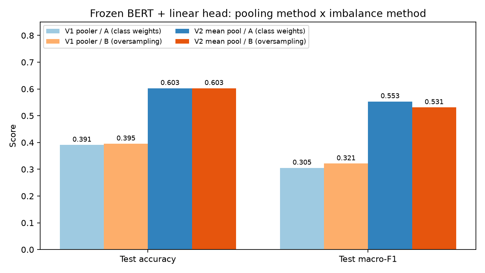
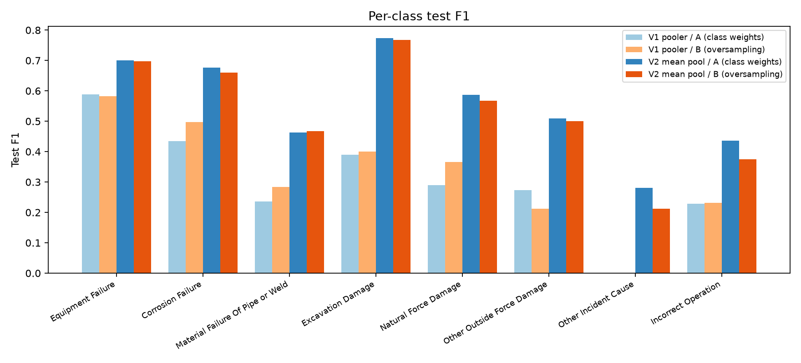

# Frozen BERT: pooler_output vs mean pooling

Both versions use the same frozen `bert-base-uncased`, the same single linear
head (768 -> 8, 6,152 trainable parameters), the same data splits and the same
hyperparameters (AdamW, lr 2e-3, batch 16, max length 512, up to 20 epochs,
early stopping patience 5 on validation macro-F1, seed 42). Only the step that
turns BERT's token vectors into one narrative vector differs.

- **Experiment A:** original training split (2,130 rows), class-weighted cross-entropy.
- **Experiment B:** training split plus 681 validated synthetic rows (2,811 rows,
  at least 300 per class), plain cross-entropy with no class weights.
- Validation (456) and test (458) rows are identical in every run.

## The two pooling methods

| | Version 1: `pooler_output` | Version 2: mean pooling |
|---|---|---|
| What the classifier sees | The `[CLS]` vector passed through BERT's pooler layer | The average of all real token vectors (padding ignored) |
| Information used | One token; the rest are discarded | Every token in the narrative |
| Run with | `python sakina/scripts/run_experiment_a.py --pooling pooler` | `python sakina/scripts/run_experiment_a.py --pooling mean` (default) |
| Results folder | `sakina/results/` | `sakina/results_mean_pooling/` |

With BERT frozen, `[CLS]` is never trained to hold what this task needs, so its
vector is a weak summary. Averaging all token vectors keeps information from the
whole narrative.

## Test results

| Version | Experiment | Accuracy | Macro-F1 | Best val macro-F1 | Best epoch |
|---|---|---:|---:|---:|---:|
| 1. `pooler_output` | A (class weights) | 0.3908 | 0.3051 | 0.3464 | 11 |
| 1. `pooler_output` | B (oversampling) | 0.3952 | 0.3212 | 0.3737 | 16 |
| 2. mean pooling | A (class weights) | 0.6026 | 0.5532 | 0.5822 | 11 |
| 2. mean pooling | B (oversampling) | 0.6026 | 0.5310 | 0.5745 | 18 |

## Per-class test F1

| Cause | V1 A | V1 B | V2 A | V2 B |
|---|---:|---:|---:|---:|
| Equipment Failure | 0.5882 | 0.5822 | 0.7000 | 0.6967 |
| Corrosion Failure | 0.4345 | 0.4972 | 0.6766 | 0.6604 |
| Material Failure of Pipe or Weld | 0.2353 | 0.2832 | 0.4626 | 0.4677 |
| Excavation Damage | 0.3896 | 0.4000 | 0.7736 | 0.7679 |
| Natural Force Damage | 0.2903 | 0.3652 | 0.5867 | 0.5679 |
| Other Outside Force Damage | 0.2740 | 0.2114 | 0.5091 | 0.5000 |
| Other Incident Cause | 0.0000 | 0.0000 | 0.2807 | 0.2128 |
| Incorrect Operation | 0.2286 | 0.2308 | 0.4364 | 0.3750 |

## Figures

Regenerate with `python sakina/scripts/make_comparison_figures.py`.

- `reports/figures/overall_comparison.png`: test accuracy and macro-F1, all four runs.
- `reports/figures/per_class_f1.png`: per-class test F1, all four runs.
- `reports/figures/validation_curves.png`: validation macro-F1 per epoch.
- Confusion matrices: `sakina/results*/experiment_*/confusion_matrix.png`.

## What the numbers show

- Mean pooling raised test macro-F1 by about 0.25 for class weights
  (0.305 -> 0.553) and about 0.21 for oversampling (0.321 -> 0.531), and accuracy
  from about 0.39 to 0.60.
- With `pooler_output`, oversampling scored slightly higher than class weights
  (0.321 vs 0.305). With mean pooling, class weights scored slightly higher
  (0.553 vs 0.531). Each gap is small, comes from one seed and one 458-row test
  set, and should not be read as a reliable winner.
- Under mean pooling, accuracy is identical for A and B (0.6026). The macro-F1
  difference comes from how errors are spread across classes.
- Other Incident Cause and Incorrect Operation remain the weakest classes in
  every run.

These are measured test-set differences. They do not show why one method scored
higher; testing that would need repeated runs with different seeds.
